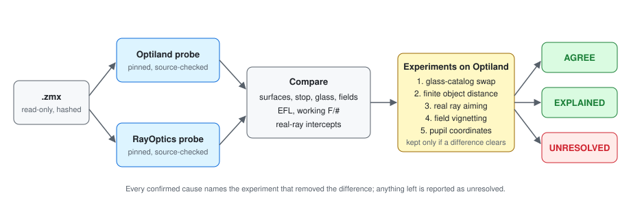

# optics-agent-skills

[](https://github.com/laweit-lxy/optics-agent-skills/actions/workflows/ci.yml)
[](LICENSE)

Agent skills for optical design that you can check. An AI coding agent (Claude Code, Codex, an MCP client, or anything that reads `SKILL.md`) gets pinned, open-source optics engines, strict read-only handling of your lens files, a second engine that independently re-derives the numbers, and a diagnosis that tests causes and reports remaining differences.

| Skill | Engine | What it does |
| --- | --- | --- |
| [`design-optical-systems`](skills/design-optical-systems/SKILL.md) | [Optiland](https://github.com/optiland/optiland) 0.6.3 | Analyzes a sequential `.zmx` prescription: EFL, F-number, spot, OPD and FFT PSF/MTF. Qualifies each run with built-in Cooke checks (including a three-point radius sweep), independent OpticStudio Hubble values, and Double-Gauss/Hubble ZMX round-trips. |
| [`cross-check-optical-designs`](skills/cross-check-optical-designs/SKILL.md) | [RayOptics](https://github.com/mjhoptics/ray-optics) @ `5009d93` | Independently loads the same `.zmx`, audits surfaces, stop, fields and glass-catalog resolution, and compares EFL and paraxial F-number against an Optiland report, or EFL and supplied paraxial/real working F-numbers against an OpticStudio reference. Returns `PASS`, `INSPECTED`, `MISMATCH` or `FAIL`. |
| [`diagnose-optical-discrepancies`](skills/diagnose-optical-discrepancies/SKILL.md) | Optiland + RayOptics | Explains a disagreement: compares both imported prescriptions surface by surface, then tests first-order and real-ray differences with glass-catalog, object-distance, ray-aiming, field-vignetting and pupil-coordinate experiments. Returns `AGREE`, `EXPLAINED` or `UNRESOLVED` with confirmed causes. |
| [`analyze-optical-designs`](skills/analyze-optical-designs/SKILL.md) | [Chromatix](https://github.com/chromatix-team/chromatix) + [Prysm](https://github.com/brandondube/prysm) (JAX) | Scalar wave optics: Fresnel/Fraunhofer/angular-spectrum propagation, pupil- and Zernike-based PSF/MTF/OTF, differentiable inverse design. Qualifies with energy-conservation, automatic-differentiation gradient and analytic diffraction-limited MTF checks. |
| [`calibrate-spectral-wavelength`](skills/calibrate-spectral-wavelength/SKILL.md) | [RASCAL](https://github.com/jveitchmichaelis/rascal) 0.3.11 | Fits a pixel-to-wavelength polynomial from peak positions you supply and a lamp or custom line list. Reports every assignment and rejection, fit and holdout errors, and withholds the coefficients when a check fails. Qualified on a synthetic Hg/Ar/Ne spectrum, not on real lamp data. |
| [`build-optomechanical-parts`](skills/build-optomechanical-parts/SKILL.md) | [CadQuery](https://github.com/CadQuery/cadquery) 2.8.0 | Builds nominal aperture mounts, baffled tubes and rigid assemblies from dimensions in a JSON file. Exports STEP and STL and checks analytic volume, bounds, the STEP roundtrip and the pose of each placed part. No tolerances, threads or collision checks. |
| [`process-radiometric-calibration`](skills/process-radiometric-calibration/SKILL.md) | [NumPy](https://numpy.org/) 2.5.4 | Convolves spectral radiance with one band response, computes top-of-atmosphere reflectance and compares GUM and Monte Carlo uncertainty. Use already-calibrated spectra; no DN conversion or atmospheric correction. |

## Why cross-check, and why diagnose

Every lens-design program imports a `.zmx` file a little differently. The three engines below evaluate the same prescriptions. The diagnosis changes one setting at a time in Optiland while holding RayOptics fixed. Differences the experiments do not remove stay unresolved:



| Sample | OpticStudio 22.2.2 EFL (mm) | RayOptics EFL (mm) | Optiland EFL (mm) | Diagnosis |
| --- | --- | --- | --- | --- |
| Cooke triplet | 50.000394 | 50.000394 | 49.999783 | The file declares `GCAT HIKARI SCHOTT`. OpticStudio and RayOptics take F2 from Hikari, Optiland 0.6.3 from Schott (index Δ ≈ 4.6e-6). With Hikari F2, Optiland gives 50.000394 mm. Optiland's main branch now resolves glasses from the file's GCAT catalogs ([optiland#930](https://github.com/optiland/optiland/issues/930)). |
| Double-Gauss | 100.003748 | 100.003748 | 100.003748 | Four glasses lack an Optiland catalog label; RayOptics reports Schott and both engines evaluate the same sampled indices. |
| Hubble | 57600.081 | 57600.081 | 57600.081 | RayOptics replaces the infinite object with a finite distance chosen for about 1 nm of image shift (about 3.3e15 mm here). The engines agree within tolerance and the diagnosis returns `AGREE`. |

Off-axis chief rays agree after iterative aiming at the real stop. The effective field-vignetting coordinates already agree. Matching the actual stop intercepts reduces the maximum pupil-edge image difference from 0.024685 mm to about 2.7e-8 mm for Cooke and from 0.001588 mm to about 1.1e-7 mm for Double-Gauss. The report retains both imported prescriptions in a surface-by-surface table. The OpticStudio values are independent measurements kept in [`tests/data`](tests/data); CI reruns the open-source engines against them on Linux and Windows.

## Install

Each engine runs in its own pinned Python 3.12 environment, because the engines pin different NumPy versions. Create the ones you need in the repository root:

```bash
git clone https://github.com/laweit-lxy/optics-agent-skills
cd optics-agent-skills
for skill in design-optical-systems cross-check-optical-designs analyze-optical-designs calibrate-spectral-wavelength build-optomechanical-parts process-radiometric-calibration; do
  python3.12 -m venv .venv-$skill && .venv-$skill/bin/pip install -r skills/$skill/requirements.txt
done
```

On Windows use `.venv-<skill>\Scripts\pip.exe`. The cross-check environment needs Git, because RayOptics is installed from its pinned commit. The diagnosis and the MCP server find environments named `.venv-<skill>` in the repository root. For environments elsewhere, set `OPTICS_SKILLS_PYTHON_DESIGN`, `OPTICS_SKILLS_PYTHON_CROSSCHECK` and `OPTICS_SKILLS_PYTHON_ANALYZE` to their interpreters.

Claude Code:

```
/plugin marketplace add laweit-lxy/optics-agent-skills
/plugin install optics-agent-skills@optics-agent-skills
```

Codex: copy or link the folders under `skills/` into `~/.codex/skills/`. The diagnosis skill also needs the repository's `src/` folder next to `skills/`, so link the skill from a full clone.

## MCP server

The shared core in `src/optics_agent_skills` is standard library only. The same code serves the skills, a command line and an MCP server (stdio, `mcp` 2.3.0):

```bash
python3.12 -m venv .venv-mcp && .venv-mcp/bin/pip install -e ".[mcp]"
```

Install from a clone with `pip install -e .`. The core runs the scripts under `skills/` and lists the samples in `tests/data`; a regular (non-editable) wheel does not contain them, so the server reports an error instead of running.

```json
{
  "mcpServers": {
    "optics-agent-skills": {
      "command": "/absolute/path/optics-agent-skills/.venv-mcp/bin/optics-agent-skills",
      "args": ["serve"],
      "env": { "OPTICS_SKILLS_OUTPUT_ROOT": "/absolute/path/for/reports" }
    }
  }
}
```

Tools: `list_samples`, `analyze_prescription`, `cross_check_prescription`, `diagnose_discrepancies`, `wave_optics_self_test`, `server_info`. Run the wavelength calibration, radiometric calibration and optomechanical scripts directly; they are not exposed as tools. The MCP tools take absolute local paths, never modify the input, and write every report into a new directory under `OPTICS_SKILLS_OUTPUT_ROOT`.

## Try it

```bash
.venv-design-optical-systems/bin/python skills/design-optical-systems/scripts/optiland_regression.py \
  --input-zmx "$PWD/tests/data/cooke/cooke-6cd4da4.zmx" --output "$PWD/out/cooke-optiland.json"

.venv-cross-check-optical-designs/bin/python skills/cross-check-optical-designs/scripts/rayoptics_crosscheck.py \
  --input-zmx "$PWD/tests/data/cooke/cooke-6cd4da4.zmx" \
  --reference-json "$PWD/tests/data/cooke/cooke-native-reference.json" \
  --output "$PWD/out/cooke-crosscheck.json"

python3 skills/diagnose-optical-discrepancies/scripts/diagnose.py \
  --input-zmx "$PWD/tests/data/cooke/cooke-6cd4da4.zmx" \
  --reference-json "$PWD/tests/data/cooke/cooke-native-reference.json" \
  --output-dir "$PWD/out/cooke-diagnosis"
```

Paths must be absolute. Existing reports and non-empty output directories are never overwritten without `--force`. Source files are hashed before and after every run.

## Tests

Install `pytest` into each environment used below. Each test file runs in the environment of the skill it covers. The diagnosis tests need the Optiland and RayOptics environments; the core and MCP suites run without them, with the MCP engine-dependent integration test skipped when they are absent.

```bash
.venv-design-optical-systems/bin/pip install pytest
.venv-design-optical-systems/bin/python -m pytest tests/test_design_optical_systems.py tests/test_diagnosis_core.py tests/test_diagnose_optical_discrepancies.py
.venv-cross-check-optical-designs/bin/python -m pytest tests/test_cross_check_optical_designs.py
.venv-analyze-optical-designs/bin/python -m pytest tests/test_analyze_optical_designs.py
.venv-calibrate-spectral-wavelength/bin/pip install pytest
.venv-calibrate-spectral-wavelength/bin/python -m pytest tests/test_calibrate_spectral_wavelength.py
.venv-build-optomechanical-parts/bin/pip install pytest
.venv-build-optomechanical-parts/bin/python -m pytest tests/test_build_optomechanical_parts.py
.venv-process-radiometric-calibration/bin/pip install pytest
.venv-process-radiometric-calibration/bin/python -m pytest tests/test_process_radiometric_calibration.py
.venv-mcp/bin/pip install -e ".[mcp,test]" && .venv-mcp/bin/python -m pytest tests/test_mcp_server.py
```

## Releasing

Every remote action (pushing a branch or tag, opening a pull request, creating a GitHub release) needs the maintainer's explicit go-ahead each time. Steps 1, 2 and 4 are local and reversible; step 3 needs a CI run on GitHub, and step 5 publishes.

1. Version: set the same number in `pyproject.toml`, `.claude-plugin/plugin.json` and `.claude-plugin/marketplace.json`.
2. Docs: update the `ROADMAP.md` row for the release (mark it released, list what shipped) and any README section the change touches.
3. Tests: run the commands above locally. The `regression` workflow (`.github/workflows/ci.yml`) runs only on a push to `main`, a pull request, its weekly schedule or a manual dispatch, so a local commit has no CI result. With the go-ahead, push the release commit to a branch and open a pull request against `main`, then confirm the workflow is green on Linux and Windows for that commit.
4. Local sync: update the installed copies of the skills on the maintainer's machine from this repository and rerun one skill self-check there, so the installed version matches the release commit that step 5 tags.
5. Publish: tag `vX.Y.Z` on the release commit, push the tag, create the GitHub release.
6. Rollback: if a release is bad, restore the previous tag's skills locally and ship a fix as the next patch version. Do not move or delete a published tag.

## Related

- [ai-zemax-optical-design](https://github.com/Jerry-del975/ai-zemax-optical-design): design loops in Ansys Zemax OpticStudio through ZOS-API. Its reports can serve as cross-check references.

See [ROADMAP.md](ROADMAP.md) for planned work: a starting-point library, a requirements-to-lens design loop and a lens-design benchmark for agents.

## License

MIT. The engines keep their own licenses (Optiland MIT, RayOptics BSD-3-Clause, Chromatix MIT, Prysm MIT, RASCAL BSD-3-Clause, CadQuery Apache-2.0) and are installed as dependencies, not vendored.
